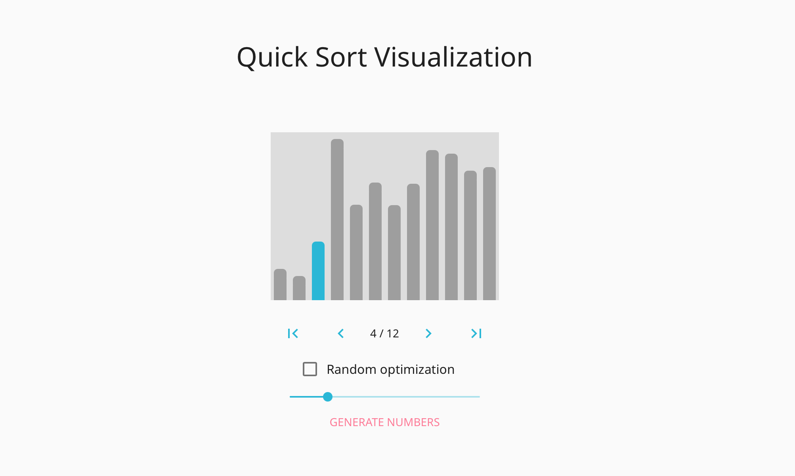

# Quick Sort Visualization

A simple Next.js-based single page app for quick sort visualization. Demo can be accessed [here](https://quick-sort-visualize.now.sh).

- `pages`: Overall document structure and state management.
- `components`: Custom components to support visualization such as number bars.
- `api`: Underlying logic code. `quickSortHistory.ts` to sort the generated numbers and corresponding history for visualization.

CSS in JS is supported by [`emotion`](https://emotion.sh/docs/introduction). Several classic components are implemented with [`material-ui`](https://mui.com/material-ui).